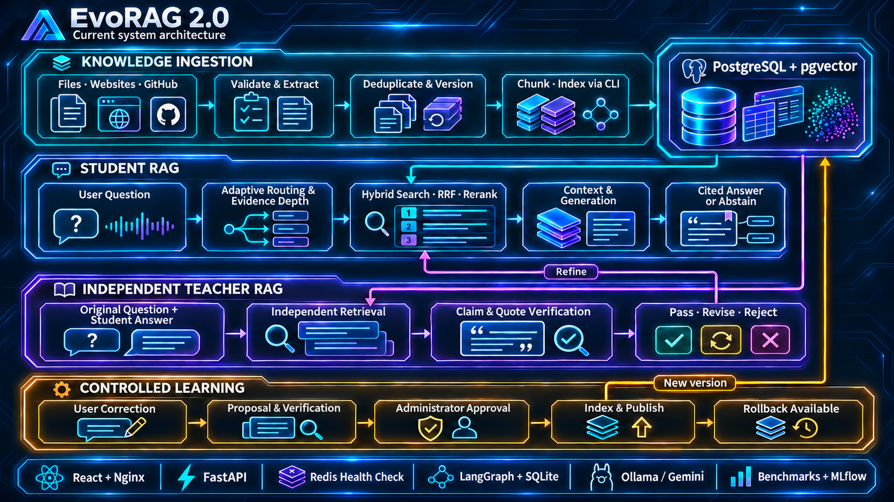

# EvoRAG 2.0

EvoRAG is a local research platform for adaptive retrieval-augmented generation. It turns versioned documents into a searchable corpus, generates answers with traceable citations, and lets an independent Teacher RAG review those answers. Administrators can verify, approve, publish, and roll back proposed knowledge corrections. The Research Lab compares retrieval and answer quality across versioned configurations.

[Architecture](#architecture) · [Quick start](#quick-start) · [Using the dashboard](#using-the-dashboard) · [API](#api) · [Development](#development) · [Verification](#verification) · [Operations](#operations) · [Current limits](#current-limits)

## Architecture



[Full-size architecture image](docs/architecture-neon.png) · [Service and deployment diagram](docs/architecture.png) · [Architecture decisions](docs/architecture.md)

| Layer | Implementation |
| --- | --- |
| Dashboard and gateway | React, Vite, TypeScript, React Router, TanStack Query, and Recharts. Nginx serves the dashboard and proxies HTTP and server-sent events from the same origin. |
| API and access | FastAPI, typed Pydantic settings, authenticated corpus access, owner-scoped conversations and runs, and administrator-only learning decisions. Sign-in uses an HttpOnly cookie with a short-lived, tab-scoped fallback for browsers that block cookies. |
| Ingestion and indexing | A separate worker claims PostgreSQL jobs, validates and extracts source content, deduplicates by SHA-256, and writes versioned documents and chunks. The indexing command writes embeddings into a specific, compatible embedding space. |
| Student RAG | Naive, Advanced, Corrective, Self-RAG, Agentic, Graph, Multi-query, HyDE, and Parent-child strategies. Auto selects a strategy and evidence depth. Advanced combines vector and BM25 search using reciprocal rank fusion and reranking. The API verifies citations before releasing answer text. |
| Independent Teacher RAG | A separately configured retrieval and generation run. It checks the Student’s answer against its own evidence, saves claim-level findings, and returns pass, revise, or reject. A revise verdict can trigger bounded refinement. |
| Controlled learning | User corrections create proposals. Verification checks evidence and applicable benchmark cases. An administrator can approve publication. The system indexes the staged version before switching the current version and can restore the prior one. |
| Data and orchestration | PostgreSQL 17 with pgvector stores knowledge, sessions, queues, ranks, and audit records. Redis responds to readiness probes. LangGraph coordinates retrieval strategies and uses SQLite for workflow checkpoints. Alembic manages schema changes. |
| Models and research | Ollama or Gemini generation, multiple embedding providers, benchmark datasets, experiment comparisons, and optional MLflow tracking and RAGAS scoring. |

## Quick start

### 1. Configure and start Docker Compose

Use Docker Engine with Compose v2 and Linux containers. On Windows with Docker Desktop, start it in Linux container mode. Run the commands from the repository root.

Copy `.env.example` to `.env` using `Copy-Item .env.example .env` in PowerShell or `cp .env.example .env` in a POSIX shell. Set a unique `POSTGRES_PASSWORD`. Keep provider keys in backend environment variables. Vite exposes values prefixed with `VITE_` to browser code.

```sh
docker compose up --build -d --wait
docker compose exec api python -m app.auth --email you@example.com
```

The first command starts PostgreSQL and Redis, applies migrations and seeds, then starts the API, worker, and frontend. The second creates your administrator and prompts for a password of at least 12 characters. Open the [dashboard](http://127.0.0.1:8080/) and sign in with the account you created. Change the URL if you set `WEB_PORT`.

### 2. Configure a model provider

For local inference, start Ollama and make it reachable from the backend container. The Compose default is `http://host.docker.internal:11434`. Set `OLLAMA_CONTAINER_URL` if your Docker setup needs a different address.

```sh
ollama pull qwen2.5:1.5b
ollama pull all-minilm:latest
docker compose exec api python -m app.rag.ollama_profile --primary qwen2.5:1.5b --teacher qwen2.5:1.5b --extractive
docker compose exec api python -m app.rag.seed_strategies
```

Note the embedding-space version printed by the profile command. The example uses an extractive answer format for a small local model. For Gemini generation, set a valid backend `GEMINI_API_KEY`, apply the environment with `docker compose up -d --wait`, and index into the embedding space associated with the selected profile. [Model profiles and providers](docs/rag.md)

### 3. Upload and index knowledge

1. Open **Knowledge Base** and upload a PDF, DOCX, TXT, Markdown, CSV, or XLSX file. You can also import a public website or GitHub repository.
2. Wait for the ingestion job to show **Completed**. Open **Document Inspector** to check extraction, chunk boundaries, page references, and version history.
3. Run the index command for the selected space and version. Replace `1` with the value printed in step 2 if it differs. Run indexing again after ingesting new content.

```sh
docker compose exec api python -m app.retrieval.index --space ollama --version 1
```

[Ingestion formats and limits](docs/ingestion.md) · [Embedding spaces and retrieval](docs/retrieval.md)

## Using the dashboard

| Area | What you can do |
| --- | --- |
| Dashboard | Check dependency readiness and recent workspace activity. |
| RAG Playground | Ask questions, select a fixed strategy or **Auto**, inspect cited passages and scores, request teacher review, refine a revise verdict, and submit feedback. |
| Knowledge Base and Document Inspector | Queue or retry ingestion and inspect document versions, chunks, and provenance. |
| Teacher Center | Inspect saved verdicts, claim grades, independent evidence, and outcome counts. |
| Learning Center | Verify a proposal, record an approval or rejection, publish and index an approved version, or roll it back. |
| RAG Comparison Lab | Run the same question through multiple strategies and compare their answers and evidence. |
| Benchmark Manager, Experiments, and Analytics | Version labeled datasets, run experiments, compare metrics, and export results. |
| Memory Center | Inspect conversation history for the signed-in user. |
| Model Registry, Workflow Manager, and Settings | Inspect available model versions, execution traces, runtime settings, and theme controls. |

For a first pass, ask **RAG Playground** a question whose answer appears in your indexed document. Inspect the cited quote, then click **Review with teacher** to see the independent evidence and claim verification. If you submit a cited correction through **Give feedback**, review the proposal in **Learning Center** before publishing. [End-to-end walkthrough](docs/workflow.md) · [Teacher review](docs/teacher.md) · [Approval and rollback](docs/learning.md)

## API

The Compose deployment serves [Swagger UI](http://127.0.0.1:8080/docs) and [OpenAPI JSON](http://127.0.0.1:8080/openapi.json). Protected routes accept the session cookie or an opaque bearer token from `POST /api/v1/auth/token`. Use the same base URL for the session and API calls.

| Operation | Method and path |
| --- | --- |
| Sign in, check a session, or sign out | `POST /api/v1/auth/login`, `GET /api/v1/auth/me`, `POST /api/v1/auth/logout` |
| Upload a file or import a remote source | `POST /api/v1/ingestion/files`, `POST /api/v1/ingestion/remote` |
| Inspect ingestion and documents | `GET /api/v1/ingestion/jobs/{job_id}`, `GET /api/v1/documents/{document_id}` |
| Query and compare | `POST /api/v1/rag/query`, `POST /api/v1/rag/query/stream`, `POST /api/v1/rag/compare` |
| Inspect an execution | `GET /api/v1/rag/runs/{run_id}` |
| Review and refine | `POST /api/v1/teacher/reviews/{run_id}`, `POST /api/v1/teacher/reviews/{review_id}/refine` |
| Submit feedback and review proposals | `POST /api/v1/rag/runs/{run_id}/feedback`, `GET /api/v1/learning/proposals` |
| Manage benchmark datasets and experiments | `GET /api/v1/benchmarks/datasets`, `POST /api/v1/experiments`, `GET /api/v1/experiments/{experiment_id}` |
| Check liveness and readiness | `GET /health`, `GET /ready` |

## Development

Use Python 3.12 with uv, plus Node.js 22.13 or later in the 22.x line, or Node.js 24 or later. Prepare the root `.env` as above. When switching from full Compose to host development, stop the full stack with `docker compose down` to release its web port and worker. The named volumes retain data.

```sh
docker compose up -d --wait postgres redis
cd backend
uv sync --locked
uv run --locked alembic upgrade head
uv run --locked python -m app.db.seed
uv run --locked python -m app.rag.seed_strategies
uv run --locked python -m app.auth --email you@example.com
uv run --locked uvicorn app.main:create_app --factory --reload
```

Create the administrator only if you need a new account. Start the ingestion worker and frontend in separate terminals.

```sh
cd backend
uv run --locked python -m app.ingestion.worker
```

```sh
cd frontend
npm ci
npm run dev
```

Open [Vite on port 5173](http://127.0.0.1:5173) or [FastAPI on port 8000](http://127.0.0.1:8000/docs). Use the same hostname for both. Match any changed frontend origin in `CORS_ORIGINS` and update `VITE_API_BASE_URL` if you move the API.

### Configuration reference

| Variables | Purpose |
| --- | --- |
| `POSTGRES_USER`, `POSTGRES_DB`, `POSTGRES_PASSWORD`, `POSTGRES_HOST`, `POSTGRES_PORT` | Database credentials and address. Compose supplies its internal service name to the backend. |
| `REDIS_HOST`, `REDIS_PORT`, `WEB_PORT` | Redis connection and published web port. |
| `CORS_ORIGINS`, `VITE_API_BASE_URL`, `SESSION_COOKIE_SECURE` | Development API access and session cookie security. Use secure cookies with HTTPS. |
| `OLLAMA_URL`, `OLLAMA_CONTAINER_URL`, `GEMINI_API_KEY` | Backend provider settings for host or container execution. |
| `MAX_UPLOAD_BYTES`, `MAX_REMOTE_BYTES`, `LOG_LEVEL`, `TEACHER_MAX_REFINEMENTS` | Ingestion limits, logging, and the maximum number of teacher-guided refinement attempts. |
| `MLFLOW_TRACKING_URI`, `EVORAG_ENABLE_RAGAS`, `RAGAS_OLLAMA_MODEL` | Optional experiment tracking and RAGAS scoring. Rebuild the image after enabling the RAGAS dependency. |
| `WORKFLOW_CHECKPOINT_DB` | SQLite checkpoint path. Compose stores it under its persistent application volume. |

[Environment template](.env.example) · [Database schema and migrations](docs/database.md) · [Evaluation setup](docs/evaluation.md)

## Verification

Use `curl.exe` in PowerShell and `curl` in a POSIX shell. Adjust the ports and PostgreSQL names if you changed them in `.env`.

```sh
docker compose ps
docker compose exec -T api alembic current
docker compose exec -T api alembic check
docker compose exec -T postgres psql -U evorag -d evorag -Atqc "SELECT vector_dims(ARRAY[1]::vector)"
docker compose exec -T redis redis-cli ping
curl --fail http://127.0.0.1:8080/health
curl --fail http://127.0.0.1:8080/ready
```

Expect the current migration, no schema drift, vector dimension `1`, Redis `PONG`, and readiness with both dependencies marked true. A dependency failure returns HTTP 503 from `/ready` while `/health` continues to report API liveness.

Run backend checks from `backend/` and frontend checks from `frontend/`.

```sh
uv run --locked pytest
uv run --locked ruff check .
uv run --locked ruff format --check .
```

Set `EVORAG_DB_TESTS=1` to enable the PostgreSQL integration suite before running pytest. In PowerShell use `$env:EVORAG_DB_TESTS = '1'`. The configured database role needs permission to create disposable test databases and install pgvector in them.

```sh
npm run lint
npm run format:check
npm run build
```

The recorded 2.0 verification passed 53 backend tests with database integration enabled and authenticated browser checks on all 14 dashboard pages at desktop and mobile widths. On one research-PDF question, fixed Advanced and Auto both answered correctly with a citation. Auto used 221 generation input tokens compared with 366, and its cited chunk ranked second compared with first for fixed Advanced. This single case demonstrates a trade-off and has limited value for judging overall accuracy or latency. [Measured benchmark report](docs/evaluation-report.md) · [2.0 verification and improvement log](docs/audits/IMPROVEMENT_LOG.md)

## Operations

Stop host development processes with Ctrl+C. Stop Compose with `docker compose down`. Named volumes retain PostgreSQL, Redis, and workflow checkpoints. Use `docker compose logs migrate api worker frontend` for startup or request diagnostics.

For a PostgreSQL archive and recovery check, run from the root with Python 3.12. Pick a new archive path and a new restore database name.

```sh
python scripts/database.py backup evorag-backup.dump
python scripts/database.py restore evorag-backup.dump --database evorag_restore
```

The restore target is a separate database. Protect backup files as you would the live corpus. Preserve the checkpoint volume, MLflow storage, and model files separately when those artifacts are needed. [Backup, restore, and deployment guide](docs/deployment.md)

| Symptom | What to check |
| --- | --- |
| Compose cannot reach Docker | Start the engine and check `docker info`. |
| Container fails to start | Check `docker compose logs migrate api worker frontend` and `docker compose ps -a`. |
| PostgreSQL is unhealthy | Check the configured role, database, password, and pgvector extension. Changing the password in `.env` does not update an existing PostgreSQL role. |
| Dashboard loads without API access | Check `/ready`. For host development, verify the API base URL and the exact configured CORS origin. |
| Ollama generation or embedding fails | Check the provider address from inside the API container and confirm the configured model artifacts were pulled. |
| Upload completed and vector search returns no results | Inspect the chunks and run the index command for the space and version used by the selected RAG profile. |
| WSL Docker build or loopback port fails | Build from a Linux filesystem when the Windows mount rejects file metadata. Check the WSL port forwarding configuration. The tested dedicated WSL setup used port 18080 through a loopback relay. [WSL deployment notes](docs/deployment.md) |

## Current limits

- The corpus is shared among signed-in workspace users. Conversations and runs are scoped to their owners, and learning decisions require an administrator.
- Scanned PDFs require an OCR adapter. Multi-column PDF reading order and table extraction depend on the source layout.
- Teacher claim segmentation and scoring use bounded independent context. Verified quotes establish provenance, and semantic judgment still depends on the teacher model.
- The recorded model runs used local Ollama. A valid key and a compatible embedding space are required for Gemini configurations. RAGAS is optional and was outside the recorded one-case benchmark.
- The AI Supervisor, separate episodic and semantic memory, and broader before-and-after benchmarks remain on the 2.0 roadmap.

[Technical audit and roadmap](docs/audits/INITIAL_TECHNICAL_AUDIT.md) · [Improvement log](docs/audits/IMPROVEMENT_LOG.md)
