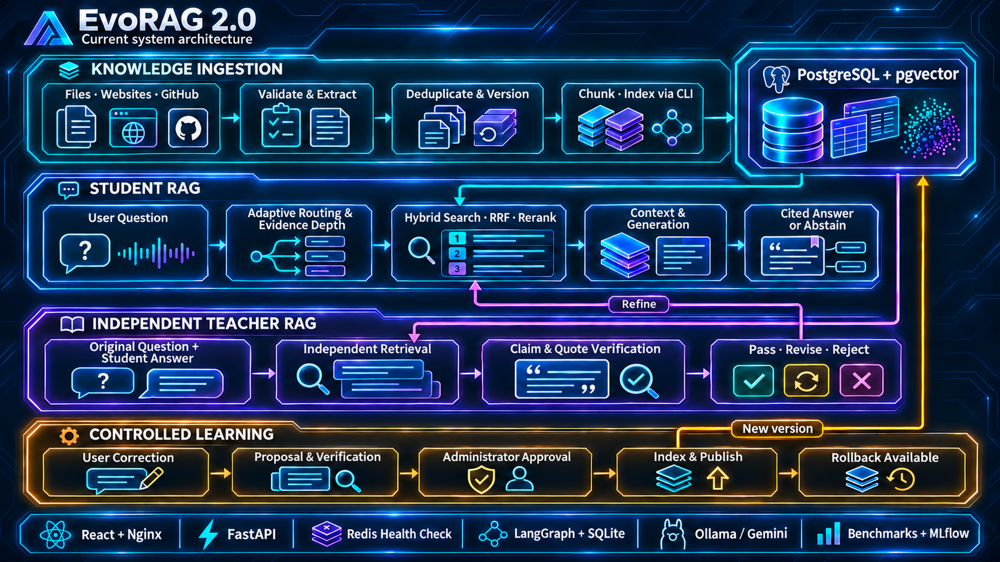

# Architecture

EvoRAG serves the React dashboard and FastAPI endpoints from one origin in Docker Compose. Nginx serves the frontend and proxies API requests, including streamed answers. FastAPI handles authentication, query and review requests, and administrative actions. A separate worker processes ingestion jobs from PostgreSQL. [End-to-end workflows](workflow.md)

[Service and deployment diagram](architecture.png)

| Path | Responsibility |
| --- | --- |
| `backend/app/api/` | HTTP routes, response schemas, and FastAPI dependency adapters |
| `backend/app/core/` | Typed environment settings and application logging |
| `backend/app/db/` | SQLAlchemy models, transaction-scoped repositories, and reference data |
| `backend/app/ingestion/` | File and remote extraction, chunking, and a durable worker |
| `backend/app/retrieval/` | Embedding providers, corpus indexing, hybrid retrieval, and reranking |
| `backend/app/rag/` | Primary RAG, independent teacher review, refinement, and strategy workflows |
| `backend/app/evaluation/` | Versioned experiment execution, metrics, exports, and optional MLflow and RAGAS integration |
| `backend/migrations/` | Alembic schema revisions |
| `backend/app/infrastructure/` | Lifespan-managed PostgreSQL and Redis clients and readiness probes |
| `backend/tests/` | API behavior, configuration, and failure handling tests |
| `frontend/src/api/` | Typed HTTP calls to the backend |
| `frontend/src/` | React dashboard, authentication, playground, and research and administration pages |
| `infra/postgres/` | Database extension bootstrap |

## Decisions

- **Local process boundaries.** Compose starts Nginx, FastAPI, the ingestion worker, PostgreSQL 17 with pgvector, and Redis 7.4. A one-shot migration service runs Alembic and seeds reference configurations before the API and worker start. For hot reload, developers can run Vite and FastAPI on the host. Published ports are bound to loopback. PostgreSQL, Redis, and SQLite workflow checkpoints use named volumes. Redis enables append-only persistence.
- **Configuration ownership.** Compose, Pydantic Settings, and Vite read the root `.env`. Vite exposes variables with the `VITE_` prefix to browser code. The API constructs its SQLAlchemy URL from the same PostgreSQL settings Compose uses, with password handling delegated to SQLAlchemy's URL builder.
- **Resource lifecycle.** The FastAPI lifespan owns the async SQLAlchemy engine and Redis client. The engine uses asyncpg to support the default asyncio event loops on Windows and Linux. Routes obtain clients through FastAPI dependencies. Tests can supply settings or override dependency bindings without a live store.
- **Probe semantics.** `GET /health` reports API liveness. `GET /ready` concurrently tests a real pgvector cast and Redis `PING` under independent two-second deadlines. The response exposes dependency status flags, and the application log records startup, shutdown, and dependency exceptions without printing connection strings.
- **Schema ownership.** Alembic creates application tables and can install pgvector in a blank database. Compose also bootstraps pgvector so PostgreSQL can pass its service health check before running application migrations. The [database schema](database.md) describes versioning and integrity rules.
- **Session transport.** Normal browser sign-in uses an HttpOnly cookie. If the browser blocks that cookie, the dashboard obtains a one-hour opaque session token and uses the Authorization header. It stores this fallback only in the current tab's session storage, with an in-memory fallback when storage is restricted. PostgreSQL stores token hashes and expiry times for both transports. Sign-out revokes the active session.
