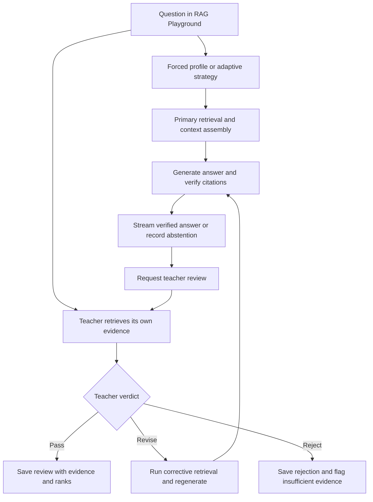
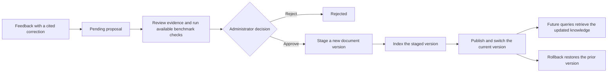

# EvoRAG workflows

The dashboard uses the same FastAPI endpoints documented at `/docs`. The [system architecture](architecture.md) describes the runtime boundaries and storage.

## Sign in and prepare the corpus

1. Open the dashboard and sign in with the administrator created during setup. If the browser blocks session cookies, the dashboard switches to a tab-scoped session automatically.
2. In **Knowledge Base**, upload a PDF or another supported file, or import a public website or GitHub repository. Select recursive, sentence-based, or semantic chunking.
3. The API validates the input and queues an ingestion job in PostgreSQL. The worker extracts text and metadata, computes a SHA-256 hash, checks for duplicates, and writes a document version and its chunks. Use **Document Inspector** to check extracted text, page references, provenance, and version history.
4. Run the index command for the embedding space used by your RAG profile. For the local Ollama space at version 1, run `docker compose exec api python -m app.retrieval.index --space ollama --version 1`. Use the version printed by your model profile command. Each vector belongs to a versioned space with a specific model and dimension. [Ingestion details](ingestion.md) · [Indexing and model setup](retrieval.md)

## Ask a question and request a teacher review

- In **RAG Playground**, choose a configuration, ask a question, and inspect the cited quotes and chunk scores. **Naive** uses a single vector query. **Advanced** builds query variants, combines vector and BM25 rankings with reciprocal rank fusion, and reranks and assembles context. **Auto** selects a strategy and evidence depth for the question. Available alternatives include Corrective RAG, Self-RAG, Agentic RAG, Graph RAG, Multi-query RAG, HyDE, and Parent-child RAG.
- Click **Review with teacher** to run independent retrieval for the same question and scope. The teacher uses its own versioned model and retrieval settings, evaluates each claim with independently retrieved evidence, and saves its report in **Teacher Center**.
- Click **Refine answer** on a revise verdict. The corrective run uses a fresh retrieval pass and applies the same citation gates. The API records the refinement and enforces the configured attempt limit. [Primary RAG](rag.md) · [Teacher RAG](teacher.md) · [Strategy workflows](strategies.md)

## Review, publish, and roll back a correction

Submit a correction from **Give feedback** under an answer with a citation. In **Learning Center**, inspect the proposal and run verification. An administrator records the approval or rejection with a reason. **Publish and index** prepares the new version and updates the current-version pointer after indexing succeeds. **Rollback** restores the prior pointer and preserves the newer version, review decisions, and audit history. [Controlled learning](learning.md)

## Evaluate and operate

- Use **Benchmark Manager** to version labeled questions, golden answers, and relevant chunks. Use **RAG Comparison Lab** to compare strategies on one question and **Experiments** to run and compare a dataset. Use **Analytics** for teacher verdicts and run measurements, and **Workflow Manager** for persisted execution traces.
- Experiments record the dataset version, model and embedding versions, retrieval and chunking settings, and prompts. Export results from the experiment record. MLflow tracks configured runs and artifacts, and RAGAS scoring can be enabled separately. The measured report records the actual benchmark scope and results. [Evaluation instructions](evaluation.md) · [Measured results](evaluation-report.md)
- Use `/health` for API liveness and `/ready` to check PostgreSQL and Redis. Compose runs schema migrations before starting the API and worker. The deployment guide covers database backups, restores, and volume boundaries. [Deployment and recovery](deployment.md)
